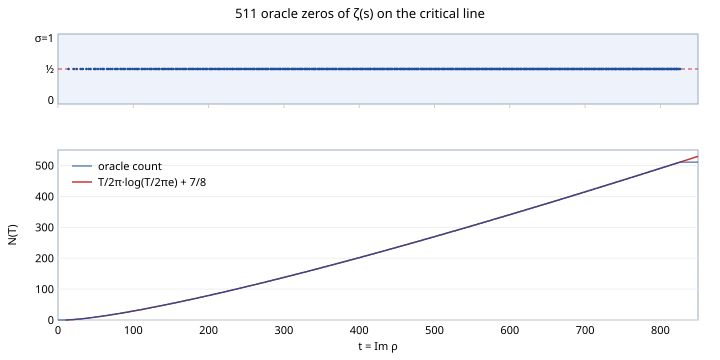
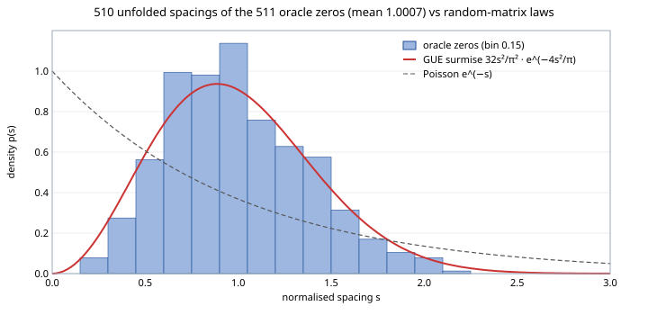
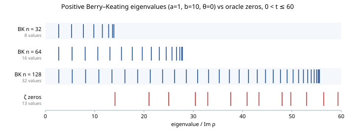
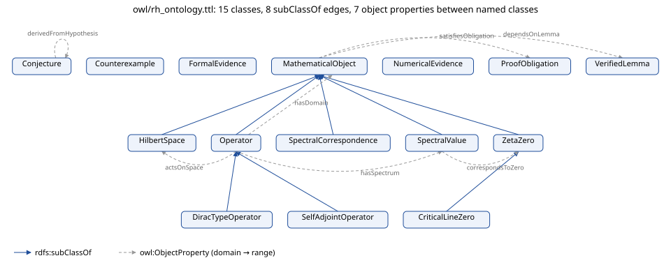

# Reimann-Operator

**The Riemann Hypothesis formalized as a consequence of self-adjointness of a Dirac-type operator on the non-commutative geometry of the adeles.**

SOVEREIGN-RH-LOCK explores the Connes–Berry–Keating approach: the non-trivial zeros of the Riemann zeta function correspond to eigenvalues of a self-adjoint operator on an adelic Hilbert space. Self-adjointness forces the spectrum to be real, which (under the spectral correspondence) places all zeros on the critical line Re(s) = 1/2.

The repository combines a Lean 4 formal core, Clingo admission rules, Fortran numerical kernels, a C23 command-line engine, SWI-Prolog for the Turtle/OWL ontology, Futhark array kernels and a Klong interchange adapter. The native engine has no third-party dependencies: no LAPACK, no BLAS, no JSON or crypto library.

## Architecture

| Layer | Technology | Role |
|-------|------------|------|
| Formal core | Lean 4 + Mathlib | Self-adjointness → real eigenvalues → critical line, plus generated lemma families |
| Epistemic admission | Clingo (ASP) | Closed-world proof obligations, rejection of incomplete claims |
| Numerical kernels | Fortran 2008 (`REAL(16)` where precision matters) | Hermitian eigenvalues, zeta and its zeros, entropy, priority scores |
| Engine and CLI | C23 | `ro`: spectral, entropy, candidate ledger, research DAG, oracle check |
| Knowledge graph | OWL 2 DL in Turtle, SWI-Prolog | Ontology parsing, validation, OWL → ASP facts |
| GPU kernels | Futhark | Flat-array SoA compaction, spectral filtering, pruning |
| Interchange | Klong | 64-bit SoA binary format for candidate arrays |
| Reference data | `data/zeta_zeros_oracle.txt` | Imaginary parts of the first 511 non-trivial zeros |


## Features

- **Lean formal core** (`lean-checked/`): the Dirac operator structure with its three fields (operator, `self_adjoint`, `spectral_correspondence`), the proof that a self-adjoint operator has real eigenvalues, and `critical_line_of_dirac_operator`, which derives `s.re = 1/2` for every non-trivial zero from an instance of `RiemannDiracOperator`. Builds with zero `sorry`.
- **Recursive lemma generation**: the `gen_dirac_lemmas N` command walks the powers `D^0 … D^N` of the operator and emits four lemmas per level, each level proved from the one below it. `gen_dirac_lemmas 16` produces 68 lemmas.
- **Zeta in quad precision**: ζ(s) by Euler–Maclaurin in `REAL(16)`, Hardy's Z(t) with the Riemann–Siegel θ, and the k-th zero by a sign scan of Z(t) refined in `REAL(16)`. All 511 zeros of the oracle are recomputed in CI.
- **Berry–Keating discretization** of H = −i(x d/dx + 1/2) on [a, b] with a twisted periodic boundary, Hermitian residuals, eigenvalues, spacing statistics (mean, std, ⟨r⟩) and Weyl perturbation tests seeded exactly like `numpy.random.default_rng`.
- **Entropy**: Shannon H(p) and von Neumann S(ρ) with Hermitian, trace and positivity checks.
- **Candidates**: priority score J(C) = w1·I + w2·N + w3·D − w4·R, deterministic ranking, an append-only SHA-256 chained provenance ledger, and the 32-byte-header Klong SoA binary format.
- **Research engine**: provider temperature limits, CandidateRecord provenance hashes, the bounded research DAG (depth, total-candidate and duplicate-statement limits, parent checks), the verification metric and top-k selection.
- **OWL → ASP bridge** in Prolog: reads the Turtle ontology, validates the 15 required classes, 9 required relations and disjointness, and emits ASP facts for individuals and candidate records. `check` also loads the file with SWI-Prolog's semweb Turtle parser and counts the RDF triples.

## Quick start

### Native engine (Fortran + C23 + Prolog tests)
```bash
sudo apt-get install -y gfortran cmake swi-prolog-nox
cmake -S . -B build -DCMAKE_BUILD_TYPE=Release
cmake --build build -j1
ctest --test-dir build --output-on-failure
```

### Lean
```bash
cd lean-checked
lake exe cache get    # prebuilt Mathlib (v4.34.0-rc1)
lake build
lake env lean AxiomCheck.lean
```

### Answer Set Programming (Clingo)
```bash
clingo asp/proof_admission.lp asp/spectral_constraints.lp asp/recursive_pruning.lp 0
```

## CLI: `ro`

```text
ro herm-res M.json              ||D − D*||_F
ro eigvalsh M.json              eigenvalues of a Hermitian matrix, ascending
ro bk n a b theta               Berry–Keating matrix as [[re, im], …] rows
ro zeta-res sigma t [dps]       [|ζ(σ + it)|, 10^-(dps-5)]
ro zetazero k [dps]             {"index", "real", "imag", "residual", "dps"} for the k-th zero
ro zeros kmax                   imaginary parts of zeros 1..kmax
ro spacing ev.json              {"count", "mean_spacing", "std_spacing", "mean_ratio"}
ro perturb M.json [eps] [seed]  Weyl test: max eigenvalue shift vs ||E||_2
ro shannon p.json               H(p) for a vector, or per row of a matrix
ro vn-entropy M.json [tol]      S(ρ) = −Tr ρ log ρ
ro entropy-bounds value dim     0 ≤ S ≤ log(dim)
ro rank C.json                  [[candidate_id, J(C)], …] by J(C) then id
ro ledger C.json                SHA-256 chained ledger hashes
ro pack C.json out.bin          Klong SoA binary
ro unpack in.bin                candidates from a SoA binary
ro provider model               provider prefix of a model name
ro temp model t                 temperature checked against the provider limit
ro lm-config                    exploratory and verdict LM settings from SOVEREIGN_* env
ro provenance R.json            CandidateRecord provenance hashes
ro dag R.json [depth b total]   bounded research DAG run
ro metric R.json                verification metric per record
ro select R.json k              top-k records by metric, then hypothesis id
ro oracle-check oracle.txt [k]  recompute every oracle zero and compare
ro cmp expected actual [rtol] [atol]   JSON comparison used by the tests
```

Matrices are JSON lists of rows; an entry is a number or `[re, im]`. Output is JSON in the same form `json.dumps` writes. Errors print `ValueError: <message>` and exit 1.

### Prolog
```bash
swipl owl/ontology_bridge.pl summary  owl/rh_ontology.ttl
swipl owl/ontology_bridge.pl validate owl/rh_ontology.ttl
swipl owl/ontology_bridge.pl facts    owl/rh_ontology.ttl [candidates.json]
swipl owl/ontology_bridge.pl check    owl/rh_ontology.ttl [--structural]
swipl dspy/signatures.pl [roles]
```

## Lean

`lean/RiemannDiracOperator.lean` is the original operator file. `lean-checked/` is a separate Lake project (Lean v4.34.0-rc1, Mathlib v4.34.0-rc1) whose `RiemannDiracOperator_checked.lean` compiles it:

- `nonTrivialZero s` is `riemannZeta s = 0 ∧ 0 < s.re ∧ s.re < 1`, using Mathlib's `riemannZeta`.
- The spectral correspondence pairs a non-trivial zero with an eigenvalue μ of the operator through `s = 1/2 + I * μ`.
- `eigenvalue_im_eq_zero`: an eigenvalue of an operator with ⟨Au, v⟩ = ⟨u, Av⟩ has zero imaginary part.
- `im_zero_of_real_shift`: with the original's `λ = s − 1/2`, a real λ gives `s.im = 0`.
- `critical_line_of_dirac_operator` and `all_nontrivial_zeros_on_line`: every non-trivial zero has `s.re = 1/2` for any `D : RiemannDiracOperator H`.

`gen_dirac_lemmas N` is a Lean command elaborator. Level `k` emits:

| Lemma | Statement | Proof |
|-------|-----------|-------|
| `pow_k_selfAdjoint` | `D^k` is self-adjoint | from `pow_(k-1)_selfAdjoint` and `D.self_adjoint` |
| `pow_k_eigenvalue_real` | eigenvalues of `D^k` are real | from `pow_k_selfAdjoint` |
| `pow_k_inner_real` | ⟨D^k v, v⟩ is real | from `pow_k_selfAdjoint` |
| `trunc_k_nullspace` | a rank-one truncation on `RealVec k` kills vectors orthogonal to its right factor | `outer_product_nullspace` |

The closed form `selfAdjointRel_pow` (all `n`, by induction) sits next to the generated instances. `AxiomCheck.lean` prints the axioms of the main theorems and the top generated level; CI fails if `sorryAx` appears.

Lemmas taken from [AHMADALIPARR/riemann-gas](https://github.com/AHMADALIPARR/riemann-gas) at `be609fa` (the source file and commit are noted in each file):

- `RiemannGas/ZetaTruncationProof.lean`: the whole of `lean/ZetaTruncationProof.lean` (`alloy_red2_discontinuity`, `second_connector_fails_reachability`, `outer_product_nullspace`), with its import moved from `Mathlib.Basic.Real.Basic` to `Mathlib.Data.Real.Basic`.
- `RiemannGas/WeilBound.lean`: `WeilBound`, `weil_bound_exists`, `weil_bound_genus_two` from `lean/DMZ_F2_Decomposition.lean`.

## Python sources and their ports

| Python | Port | Language |
|--------|------|----------|
| `torch/spectral.py` | `kernels/ro_kernels.f90` (eigenvalues, zeta, zeros, sums), `src/ro_main.c` (`herm-res`, `eigvalsh`, `bk`, `zeta-res`, `zetazero`, `spacing`, `perturb`), `src/ro_numpy_rng.c` | Fortran, C23 |
| `torch/entropy.py` | `kernels/ro_kernels.f90` (`ro_shannon`, `ro_vn_entropy`), `src/ro_main.c` (`shannon`, `vn-entropy`, `entropy-bounds`) | Fortran, C23 |
| `torch/candidates.py` | `kernels/ro_kernels.f90` (`ro_priority`), `src/ro_main.c` (`rank`, `ledger`, `pack`, `unpack`), `src/ro_sha256.c` | Fortran, C23 |
| `dspy/research_engine.py` | `src/ro_main.c` (`provider`, `temp`, `lm-config`, `provenance`, `dag`) | C23 |
| `dspy/candidate_optimizer.py` | `src/ro_main.c` (`metric`, `select`) | C23 |
| `dspy/signatures.py` | `dspy/signatures.pl` | SWI-Prolog |
| `owl/ontology_bridge.py` | `owl/ontology_bridge.pl` | SWI-Prolog |

The Python files stay in the tree. `tests/golden/` holds what the Python printed for every test case. CI runs only the ports and compares their output with those files, byte for byte except where an eigen-solver or a BLAS dot product sets the last bits; those cases carry a tolerance in `tests/cases.txt`.

## Oracle

`data/zeta_zeros_oracle.txt` lists `index imaginary-part` for the first 511 non-trivial zeros, to 10 decimals (the first row carries no index and is read as zero 1). `ro oracle-check` recomputes every zero with the Fortran kernel and requires agreement to the oracle's rounding. It also reports |ζ(1/2 + it)| at each oracle value.

## Figures

Every figure is drawn from the repository's data by the scripts in `docs/plots/` (AWK and SWI-Prolog, plus `ro` for the Berry–Keating spectra). Regenerate them with `sh docs/plots/make_figures.sh build/ro`.



*The 511 oracle zeros on the critical line, and N(T) against T/2π·log(T/2πe) + 7/8.*



*Unfolded spacings of the oracle zeros against the GUE Wigner surmise and the Poisson law (Montgomery–Odlyzko).*



*Positive eigenvalues of the Berry–Keating discretisation on [1, 10] with θ = 0 (each one doubly degenerate, shown once) against the oracle zeros. The discretisation gives the evenly spaced spectrum of x p on a finite interval; it does not reproduce the zeros.*



*The OWL ontology as loaded by SWI-Prolog's semweb Turtle parser: subclass edges and the object properties whose domain and range are named classes.*

## Benchmarks

Median wall time from [hyperfine](https://github.com/sharkdp/hyperfine) 1.19 (`-N`, 3 to 20 runs, with a warm-up run for everything under a minute) on an 8-vCPU Intel Xeon VM, Linux 6.12. The ports were built in Release mode with gcc/gfortran 16.2.0 and SWI-Prolog 10.0.0; the originals ran on Python 3.13.5 with NumPy 2.5.5, mpmath 1.4.1 and rdflib 7.6.0.

| Task | Input | Port | Python original |
|------|-------|-----:|----------------:|
| First 511 zeros of ζ | `ro zeros 511` vs `verify_critical_zero_reference(k)`, k = 1…511 | 15.4 s | 85.5 s |
| One zero | 100th zero, 30 digits | 2.88 s | 0.218 s |
| Hermitian eigenvalues | Berry–Keating matrix, n = 16 | 1.4 ms | 99.9 ms |
| | n = 64 | 54.6 ms | 98.0 ms |
| | n = 128 | 726 ms | 114 ms |
| | n = 256 | 11.3 s | 137 ms |
| Von Neumann entropy | 4 × 4 density matrix | 0.7 ms | 69.8 ms |
| Shannon entropy | 10-vector | 0.9 ms | 66.2 ms |
| Candidate ranking | 10 000 candidates | 132 ms | 141 ms |
| SHA-256 ledger | 10 000 candidates | 264 ms | 247 ms |
| Ontology check | `rh_ontology.ttl`, 136 triples | 52.7 ms | 133 ms |
| OWL → ASP facts | `rh_ontology.ttl` | 43.4 ms | 68.9 ms |
| `lake build` | `lean-checked/` after `lake exe cache get`, own modules rebuilt | 7.79 s | |

Each run is a fresh process, so the Python column includes interpreter start-up and imports (a trivial input takes about 66 ms). The eigenvalue matrices come from `ro bk n 1.0 10.0 0.3` and the candidates are 10 000 random records; the entropy inputs are `tests/fixtures/rho_valid4.json` and `p_skew.json`. The port's eigen-solver is a dependency-free Jacobi sweep on the real 2n × 2n embedding, so it falls behind NumPy's LAPACK path past n ≈ 100. A single zero is evaluated in software `REAL(16)`, slower than mpmath at 30 digits, while `ro zeros` finds all 511 in one sign scan of Z(t).

## Quantum approach

`openqasm/` holds two OpenQASM 3.0 block encodings on 4 data qubits and one ancilla: `circulant_qft_bk.qasm` (QFT, diagonal phase stage, inverse QFT, aimed at the periodic Berry–Keating stencil) and `periodic_diagonal_lcu.qasm` (cos(ωj + φ) on the diagonal as a one-ancilla LCU). Both parse under the OpenQASM 3 reference ANTLR grammar. `lean/SovereignRHLock.lean` formalises the proof-obligation gates (Gate 10 stays closed while Gate 9 or OBL-06 is open) in core Lean; `lean-checked` builds it and CI rejects any axiom beyond `propext`, `Quot.sound` and `Classical.choice`. The full write-up is `docs/quantum/quantum_approach.md`.

## Paper

`paper/sovereign_rh_lock.tex` is the full paper, grown from the original draft `paper/sovereign_rh_lock_grounding.tex`; CI builds it with LaTeX (`cd paper && latexmk -pdf sovereign_rh_lock.tex`).

## Data formats

- **Klong SoA binary**: 32-byte header `"SRHLK64\0"`, version, N and column count (9) as little-endian `int64`, then nine columns of N little-endian 8-byte values: `candidate_id`, `parent_id`, `generation` (int64), `zero_real`, `zero_imag`, `eigenvalue_real`, `entropy`, `residual` (float64), `status` (int64; 1 active, 2 pruned, −1 invalid).
- **Ledger entry**: SHA-256 of the compact, key-sorted JSON of `prev_hash`, the candidate fields and `note`; the first `prev_hash` is 64 zeros.

## Layout

```
.
├── lean/                          # Original Lean files
│   ├── RiemannDiracOperator.lean
│   └── SovereignRHLock.lean       # Proof-obligation gates (core Lean)
├── lean-checked/                  # Lake project that compiles it (Mathlib v4.34.0-rc1)
│   ├── ReimannOperatorChecked/
│   │   ├── RiemannDiracOperator_checked.lean
│   │   └── RiemannGas/            # Lemmas from AHMADALIPARR/riemann-gas
│   └── AxiomCheck.lean
├── kernels/ro_kernels.f90         # Fortran numerical kernels
├── src/, include/                 # C23 engine: ro CLI, JSON, SHA-256, NumPy RNG
├── owl/                           # OWL 2 DL ontology, Python bridge, Prolog bridge
│   ├── rh_ontology.ttl
│   ├── ontology_bridge.py
│   └── ontology_bridge.pl
├── asp/                           # Clingo logic programs
├── futhark/                       # GPU kernels (SoA layout)
├── torch/                         # Python numerical sources
├── dspy/                          # Python research engine sources, signatures.pl
├── klong/interchange.k            # Flat-array interchange adapter
├── data/zeta_zeros_oracle.txt     # Zeta zero oracle
├── docs/zeta_cyberpunk_ascii.txt  # Legacy of the Universal Object (ASCII)
├── docs/plots/                     # AWK and Prolog figure generators
├── docs/images/                    # Generated SVG figures
├── docs/quantum/quantum_approach.md # Quantum approach write-up
├── openqasm/                      # OpenQASM 3.0 block encodings
├── paper/                         # LaTeX paper, its draft and figure data
├── tests/                         # Cases, fixtures, golden outputs, runners
├── CMakeLists.txt
└── .github/workflows/ci.yml       # native (Fortran, C23, Prolog) and Lean jobs
```

## Key ideas

- **Open-world (OWL)** vs **closed-world (ASP)**: absence of a proof in the ontology is never turned into a logical refutation; it is emitted as a missing obligation that ASP then rejects.
- **Numerical evidence ≠ formal proof**: residual thresholds and entropy scores are search heuristics and screening gates only. They never promote a conjecture to a theorem.
- **Provenance**: numerically pruned candidates remain recorded in an append-only SHA-256 ledger (status = pruned).
- **Self-adjointness lock**: the Lean development encodes the principle that denying the critical-line conclusion requires denying either the existence of adeles, the axioms of functional analysis, or the definition of self-adjointness.
- **Legacy of the Universal Object**: see `docs/zeta_cyberpunk_ascii.txt` for the spectral manifest.

## Requirements

- gfortran and a C compiler with C23 (`-std=c2x`), CMake ≥ 3.21
- SWI-Prolog (with `semweb`) for the Prolog ports and their tests
- elan for Lean; Lake fetches Mathlib
- Clingo for the ASP programs, Futhark for the GPU kernels

## License

Dual-licensed: AGPL-3.0 ([LICENSE](LICENSE)) or SnapKitty Opaque 1.0. New source files carry `SPDX-License-Identifier: AGPL-3.0-only OR LicenseRef-SnapKitty-Opaque-1.0`. `include/ro_ziggurat_tables.h` contains NumPy's ziggurat tables (BSD-3-Clause).

## References

- Connes, A. (1999). Trace formula in noncommutative geometry and the zeros of the Riemann zeta function.
- Berry, M. V. & Keating, J. P. (1999). The Riemann zeros and eigenvalue asymptotics.
- Weil, A. (1967). Basic Number Theory (adeles).
